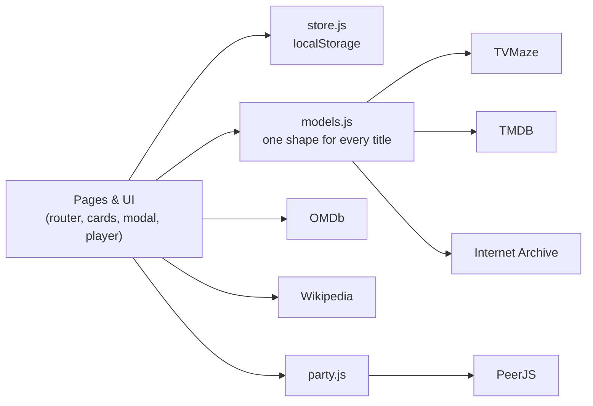

<div align="center">


# MYFLIX

**A Netflix-style streaming experience built with nothing but HTML, CSS and JavaScript.**

Browse TV and movies, stream legendary films for free, find what's free to watch in your country, track your episodes and host watch parties.


[Features](#features) · [Getting started](#getting-started) · [Configuration](#configuration) · [Architecture](#architecture) · [Credits](#credits)

</div>

---

## Overview

MYFLIX recreates the feel of a modern streaming service in the browser, with no frameworks, bundlers or backend. It brings together six public data sources into one interface:

| Source | Role | Key |
|---|---|---|
| [TVMaze](https://www.tvmaze.com/api) | TV shows, cast, seasons, episodes, air dates, local TV schedule | Not needed |
| [TMDB](https://www.themoviedb.org/) | Movies, trailers, backdrops, streaming availability per country | Free |
| [OMDb](https://www.omdbapi.com/) | IMDb, Rotten Tomatoes and Metacritic scores | Free |
| [Wikipedia](https://www.wikipedia.org/) | "Did you know?" facts, film posters, trivia questions | Not needed |
| [Internet Archive](https://archive.org/details/feature_films) | Public-domain films streamed inside the app | Not needed |
| [PeerJS](https://peerjs.com/) | Peer-to-peer connections for watch parties | Not needed |

## Features

### Browsing
- Hero billboard, Top 10 rows with outlined rank numbers, and hover preview cards
- "More Info" pop-up and an expanding search box
- Dedicated pages for TV Shows, Movies, Watch Free, My List and Games, each with genre filters
- Mobile bottom tab bar
- Light and dark themes, with consistent line iconography throughout

### Watch free
- **The MYFLIX Theatre**: 33 public-domain and Creative Commons films, with at least two per genre. Pick a genre, pick a film, and it plays in a full-screen player.
- **The player**:
  - Resume where you left off, skip ±10 seconds, use keyboard shortcuts
  - "Up next" autoplay at the end of a film
  - If a copy fails to load, it automatically tries another
- **Free in your country**: rows of movies and shows that are free (or free with ads) where you live, grouped by service. The data is live from JustWatch via TMDB.
- **Watch free on…**: every title's pop-up links straight to services that carry it for free, such as Tubi, Plex, YouTube, The Roku Channel and Rakuten Viki.
- **Free streaming directory**: Tubi, Pluto TV, Plex, The Roku Channel, Crackle, YouTube Movies & TV, Kanopy and Rakuten Viki, each marked as available or not in your country.

### Title details
- Cast, trailer, and scores from TVMaze, TMDB, IMDb, Rotten Tomatoes and Metacritic
- Where to watch, split into free, subscription, rent and buy
- "Did you know?" facts from Wikipedia, and "More like this"

### Personal
- **My List**: Want to Watch and Watched tabs, with 1–5 star ratings
- **Episode tracker**:
  - Tick off episodes, and "Continue Watching" shows your next one
  - The notification bell counts down to new episodes of shows you follow
- **Recommendations**: "Because you saved…", weighted by your genres and ratings
- **Stats**: hours watched, top genres, a 14-day activity chart and nine unlockable badges

### Social and play
- **Watch party**:
  - Watch a film in sync with friends using a six-letter code or invite link
  - Live chat and reactions while you watch
- **Mood picker**: choose a mood, spin the wheel, get tonight's pick
- **Guess the Title**: four game modes (Movies, Series, Live TV and Film Trivia), with a countdown, speed and streak bonuses, and saved high scores

### Platform
- **Installable**: it's a Progressive Web App with offline support
- **Works offline-first** for data you've already loaded
- **Opens straight from disk**: no server or build step required
- **Keeps your data**: data saved by older versions is migrated automatically

## Getting started

### Run locally

```bash
git clone https://github.com/ammara-tech/myflix.git
cd myflix
```

Then open `index.html` in your browser. That's it: there is nothing to install or build.

For the full experience (offline mode and app install), serve the folder over HTTP, for example with the **Live Server** extension in VS Code, or:

```bash
python3 -m http.server 8000   # then visit http://localhost:8000
```

### Deploy to GitHub Pages

1. In the repository, open **Settings → Pages**.
2. Under *Build and deployment*, choose **Deploy from a branch**, then `main` and `/ (root)`, and save.
3. The site is published at `https://ammara-tech.github.io/myflix/`.
4. To install it, open the site and choose **Profile → Install app** (on iPhone: **Share → Add to Home Screen**).

> After changing any file, bump `CACHE_VERSION` in `sw.js` so installed copies pick up the new version.

## Configuration

MYFLIX works without any keys. Two optional free keys unlock more:

| Key | Unlocks | Where to get it |
|---|---|---|
| TMDB | Movies page, trailers, free-in-your-country rows, where to watch | [themoviedb.org/settings/api](https://www.themoviedb.org/settings/api) |
| OMDb | IMDb, Rotten Tomatoes and Metacritic scores | [omdbapi.com/apikey.aspx](https://www.omdbapi.com/apikey.aspx) |

**There are two ways to add them:**
- **Per user (recommended):** open **Profile → Settings & API keys** and paste the keys. They are stored only in that browser.
- **For every visitor:** set `tmdbApiKey` / `omdbApiKey` in [`js/config.js`](js/config.js). This exposes the keys publicly, so only use keys you are comfortable sharing.

The *Where to watch* country defaults to South Africa (`ZA`). You can change it in Settings or in `js/config.js`.

## Architecture



- **No build step.** Scripts are plain deferred `<script>` files sharing one `MyFlix` namespace, so the app runs straight from disk. The script order in `index.html` matters.
- **One title model.** TVMaze shows, TMDB movies and classic films are normalised into the same shape, so every card, row and pop-up works with any source.
- **Hash routing.** `#/`, `#/tv`, `#/movies`, `#/classics`, `#/my-list`, `#/games`, `#/stats`, `#/search?q=` and `#/party/CODE`.
- **Caching.** Slow lookups (Wikipedia, Internet Archive, OMDb) are cached in `localStorage`. The service worker caches the app shell and artwork.
- **Resilient playback.** For each classic film, `api/archive.js` tries known Internet Archive items first, then searches by title and year, then picks the best MP4. The result is remembered for 30 days.

### Project structure

```
myflix/
├── index.html              App shell, navigation, dialogs, script order
├── manifest.webmanifest    PWA metadata
├── sw.js                   Service worker
├── assets/                 App icons and placeholder artwork
├── css/
│   ├── base.css            Design tokens (dark + light), buttons, forms, toast
│   ├── nav.css             Top bar, menus, mobile tab bar, footer
│   ├── billboard.css       Hero banner
│   ├── rows.css            Rows, cards, hover previews, Top 10, grids
│   ├── modal.css           Title details, mood picker, settings
│   ├── player.css          Full-screen player, watch party
│   ├── pages.css           Theatre, services directory, My List, stats
│   └── games.css           Games page
└── js/
    ├── theme.js            Light/dark theme (loaded first)
    ├── config.js           Optional keys and region
    ├── icons.js            Bundled Lucide icon sprite
    ├── data/               Classic films, free services, genres & moods, quiz questions
    ├── utils.js            Helpers: escaping, caching, formatting, toast
    ├── store.js            Saved data: list, episodes, progress, history, settings
    ├── models.js           Normalises TVMaze / TMDB / classic titles
    ├── api/                tvmaze · tmdb · omdb · wiki · archive
    ├── ui/                 cards · billboard · details · player · mood · settings
    ├── pages/              helpers · browse · library · games
    ├── party.js            Watch party
    ├── recommend.js        Recommendations
    ├── tracker.js          Up next and new-episode notifications
    ├── router.js           Routing and navigation
    ├── pwa.js              Install prompt and service worker
    └── main.js             Entry point
```

### Adding a classic film

Add an entry to `MyFlix.classics` in [`js/data/classics.js`](js/data/classics.js):

```js
{ id: "my-film", title: "My Film", year: 1931, runtime: 85, genres: ["horror"],
  licence: "Public domain", description: "One or two sentences in your own words." }
```

Optionally add `archiveIds: ["ArchiveItemId"]` to skip the search step. Only add films that are in the public domain or released under a Creative Commons licence.

## Content and licensing

- **Films that play inside MYFLIX** are public domain in the United States or licensed under Creative Commons. They stream from the Internet Archive.
- **Other services** (Tubi, Pluto TV, Plex, The Roku Channel, Crackle, YouTube, Kanopy, Rakuten Viki) are licensed, ad-supported or library-funded platforms. MYFLIX only links to them, because they don't permit embedding. Availability differs by country.
- **Unlicensed sources:** MYFLIX does not link to or embed streams from unlicensed sources.

## Browser support

Current versions of Chrome, Edge, Firefox and Safari, on desktop and mobile. Watch parties use WebRTC.

## Roadmap

- [ ] Profiles (several people on one device)
- [ ] Optional cloud sync for My List and the episode tracker
- [ ] Subtitles for classic films where the Internet Archive provides them
- [ ] Live TV channel guide

## Credits

- TV data: [TVMaze](https://www.tvmaze.com/api), licensed CC BY-SA
- Movie data: [TMDB](https://www.themoviedb.org/). *This product uses the TMDB API but is not endorsed or certified by TMDB.*
- Streaming availability: [JustWatch](https://www.justwatch.com/), via TMDB
- Scores: [OMDb API](https://www.omdbapi.com/)
- Facts and posters: [Wikipedia](https://www.wikipedia.org/), licensed CC BY-SA
- Films: [Internet Archive](https://archive.org/)
- Icons: [Lucide](https://lucide.dev), ISC licence
- Typefaces: [Inter](https://rsms.me/inter/) and [Bebas Neue](https://fonts.google.com/specimen/Bebas+Neue)
- Watch party: [PeerJS](https://peerjs.com/)

MYFLIX is an independent portfolio project and is not affiliated with Netflix or any of the services above.

## Author

**Ammara Badat** · [@ammara-tech](https://github.com/ammara-tech)

© 2026 Ammara Badat. All rights reserved.
